<table>
<tr>
<td>

# Kathan Somani

**Security Engineer · Data Protection · Zero Trust · Security Automation**

I work on data loss prevention, Zero Trust and detection engineering, and I build the security tools I wish I had: DLP agents, threat-intelligence platforms and analyst consoles, mostly in Python and TypeScript.

	

	

---

### Security & Technologies

---

### Projects

**[AgentBrain](https://github.com/Kathan2004/AgentBrain)**: local-first continuity layer for AI coding agents. A task's objective, progress, decisions and Git state live with the repository, so work moves between Claude Code, Codex, Copilot, Cursor and local models without starting over. A web control room shows every agent at work; a lead agent or a voting review council decides what lands, with evidence checks and a full audit of who wrote and approved each change. Machines join a shared hub to see each other's tasks and delegate work across them, with model tiers, autopilot and an Obsidian-style memory vault.
TypeScript · Node.js · MCP · ACP · Git worktrees

**[Tron](https://github.com/Kathan2004/Tron-the-DLP-Agent)**: production-ready, open-source endpoint and web DLP. Python agents (macOS, Linux, Windows) watch the clipboard, USB, file uploads and outbound network volume; a Chrome extension inspects web pastes and uploads; a React console handles fleet, policies, exceptions, governance and SIEM forwarding. Detection runs 53 validated detectors (Luhn, Verhoeff, mod-97 and more), Exact Data Match and document fingerprinting over PDFs, Office files, archives and OCR'd images, and redacts every value before an LLM triage step scores risk. Per-agent keys, encryption at rest, a hash-chained audit trail and a hardened container deployment.
Python · Flask · React · Chrome MV3 · Docker

**[CyberRegis](https://github.com/Kathan2004/CyberRegis_Server)**: threat intelligence and security analysis platform combining IOC reputation (VirusTotal, AbuseIPDB, Shodan), live threat feeds, domain checks, PCAP analysis and high-risk-only alerting. Co-authored a research paper on it with faculty; reached 98.5% URL threat-detection accuracy in controlled evaluation. [Server](https://github.com/Kathan2004/CyberRegis_Server) · [Client](https://github.com/Kathan2004/CyberRegis-Client)
Python · Flask · Next.js · TypeScript

**Artemis** (private): RAG assistant for third-party risk management. Answers questions over TPRM policies and runs vendor assessments with source-cited findings.
Python · ChromaDB · Gemini · Streamlit

#### Tools

**[Converter Studio](https://github.com/Kathan2004/converter-studio)**: browser-only file toolkit. Compress, merge, split, protect (AES-256), sign and repair PDFs; convert and OCR images (including HEIC and QR codes); convert JSON, CSV, Excel, YAML and XML; Markdown, Word and HTML to PDF; ZIP, password ZIP, hashing and AES-256-GCM file encryption. Everything runs locally in the browser and nothing is uploaded. [Live site](https://converterstudio.netlify.app/) · [Release 2.4.0](https://github.com/Kathan2004/converter-studio/releases/tag/v2.4.0)
JavaScript · WebAssembly · Tesseract · qpdf · Netlify

**[DanglingBlob](https://github.com/Kathan2004/DanglingBlob--File-to-Link)**: self-hosted file drop. Uploads become expiring, optionally password-protected share links, with no database.
Netlify Functions · Netlify Blobs

---

### Play Tic-Tac-Toe Against the Firewall

	

<a href="https://kathan2004.github.io/Kathan2004/"><b>Play now</b></a> &nbsp;·&nbsp; three difficulty levels &nbsp;·&nbsp; the unbeatable one has never lost

---

### Also

[Cybersecurity notes](https://github.com/Kathan2004/Notes), organised by chapter, plus a [Security+ SY0-701 practice bank](https://kathan2004.github.io/Notes/security-plus-701/) with 900 original questions.

### Connect

[LinkedIn](https://linkedin.com/in/kathansomani2004)

</td>
</tr>
</table>
